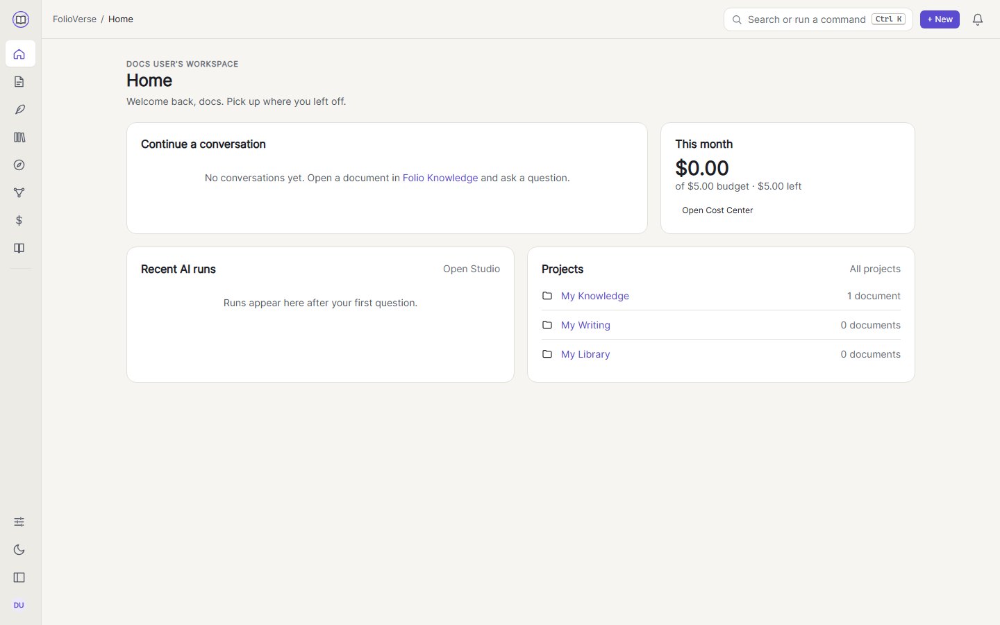
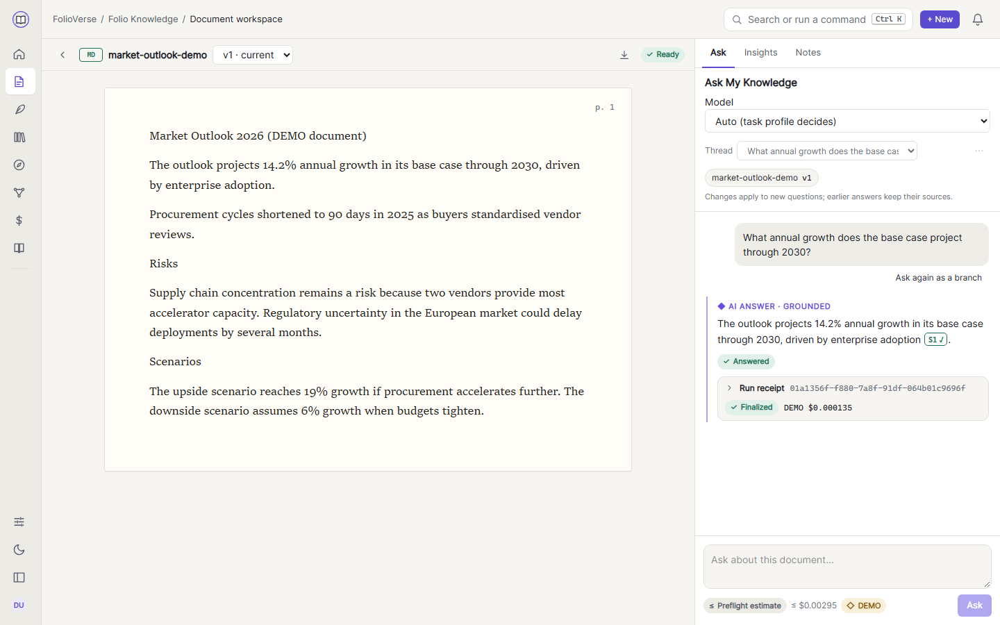
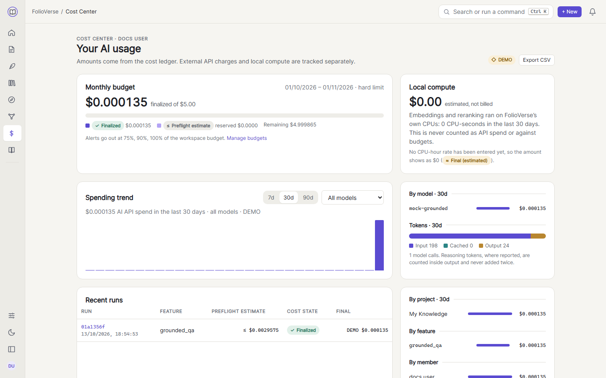

FolioVerse is a workspace for reading, researching and writing with AI help that always shows its sources and
its cost.

## Workspaces and projects

Everything lives in a **workspace**. You get a personal workspace when you register; team workspaces have
members with the roles Owner, Admin, Editor or Viewer. People who are not members of a workspace cannot see
anything in it, not even that it exists.

A workspace holds three kinds of project:

| Project | Holds | Where |
| --- | --- | --- |
| Knowledge | Uploaded documents (PDF, DOCX, Markdown, text) and the answers, notes and artifacts made from them | Folio Knowledge |
| Writer | Manuscripts with chapters and scenes, revisions, Narrative DNA and research notes | Folio Writer |
| Library | Your EPUB books, reading progress and annotations | Library |

## Grounded answers

Open a document and ask a question in the chat. The answer cites the exact version and passage of each
source; select a citation chip to jump to the quoted passage. Chips show whether each quote was verified
(VALID), only partly supported (WEAK) or could not be found (UNRESOLVED). If the documents do not contain an
answer, FolioVerse says so instead of guessing, and that abstention costs nothing because no model is called.

Insight actions turn a document into a summary, key facts, study notes, flashcards, a quiz or a knowledge
map. Each artifact keeps its citations, and you can pin passages, add notes and search across everything.

## Writing

Folio Writer is a manuscript editor with an outline of parts, chapters and scenes. Every save is a revision you
can restore. Ask for suggestions (rewrite, expand, shorten, change tone, improve dialogue or continue the scene)
and accept or reject each variant; accepted text is marked as AI-assisted in the revision history.

Narrative DNA keeps your story's canon: characters, places and facts. AI extraction only *proposes* facts;
nothing becomes canon until you approve it. The continuity check then flags sentences that contradict canon,
for example a character's eye colour changing between chapters. Research notes link a scene to a quoted
passage from a document or a book.

## Reading

The Library reads EPUB books with chapters, paper, sepia and night themes and adjustable text, remembers where you stopped, and keeps
highlights and notes. "Explain this passage" answers using only the pages you have already read, so it never
spoils what comes next.

## Discover

Discover recommends books and films from a catalog based on the genres, moods, themes and titles you pick.
Every recommendation explains why it was chosen (the factors and shared themes behind its score), and saving a
book puts it on your Library shelf. The current catalog is synthetic DEMO data.

## Costs

Every AI action is metered. Before a run starts, FolioVerse estimates its cost and checks your budgets; a run
that would exceed a hard budget is rejected before any model call. The Cost Center shows what you have spent
by day, feature and model, and every answer has a receipt with its exact token counts and cost.

