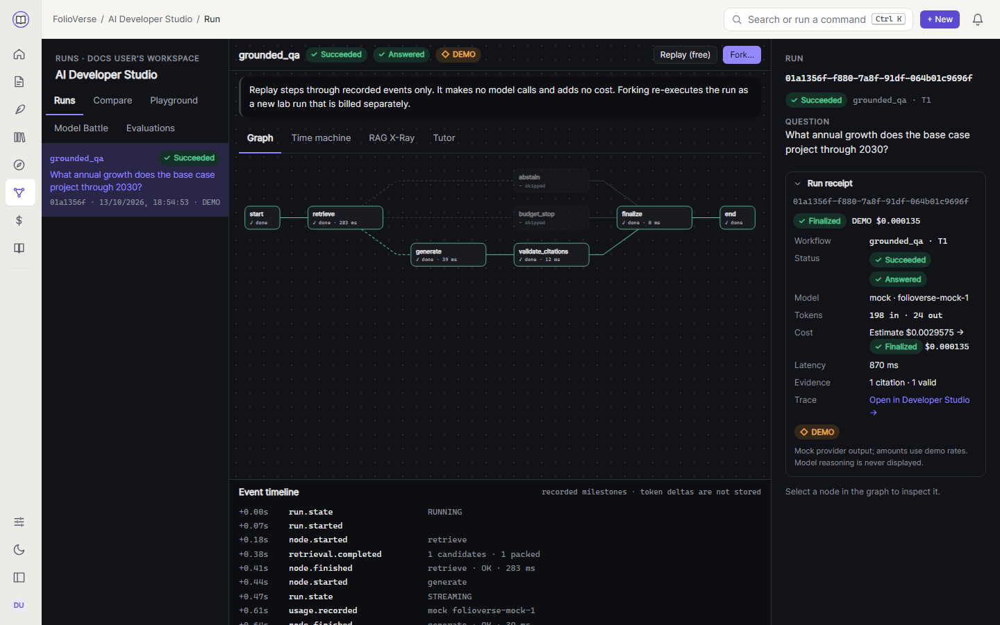

This walkthrough follows one question asked in a document's chat. The same path serves every AI action
(insights, writer suggestions, passage explain, recommendation explanations); only the graph differs.

## 1. The browser creates a run

The chat panel posts a run spec to the API. Cookies carry the session (`fv_at` access cookie, HttpOnly), and the
`x-csrf-token` header repeats the CSRF cookie.

```http
POST /api/workspaces/{workspaceId}/runs
{ "graph": "grounded_qa",
  "input": { "question": "What annual growth does the base case project through 2030?" },
  "scope": { "sourceIds": ["…"] } }
→ 201 { "runId": "…", "threadId": "…", "status": "QUEUED", "estimate": "…", "model": { … } }
```

## 2. The API authorizes, estimates and reserves

`RunsService` checks workspace membership (non-members get 404), resolves the scope to exact source *versions*,
picks a model plan from the registry, estimates the cost from the current price and **reserves** that amount
against every applicable budget (workspace, user, project). If a hard budget would be exceeded, the run ends as
`BUDGET_REJECTED` before any model call. Otherwise the run row is written as `QUEUED` and a job goes onto the
BullMQ `ai-runs` queue.

## 3. The worker streams the run from the AI service

The worker (`apps/api/src/worker.ts`) claims the run (`QUEUED` → `RUNNING`), signs a short-lived ES256 **scope
token** listing the allowed source versions, and calls the AI service at `POST /internal/runs/units`. The AI
service trusts only that token for retrieval filters, never request fields.

The AI service executes the `grounded_qa` LangGraph graph and streams events back as NDJSON
(`application/x-ndjson`):

```text
retrieve → (abstain | budget_stop | generate) → validate_citations → finalize
```

- `retrieve` runs hybrid search in Qdrant (dense + BM25 sparse, fused with RRF, optionally reranked) and packs
  passages under the context budget. See [RAG pipeline](rag-pipeline.md).
- With no supporting passage the graph goes to `abstain`: no model call, no cost.
- `generate` calls the model through the provider layer (mock, OpenAI or Ollama) and streams `token.delta`.
- `validate_citations` checks every quoted passage against the stored text and marks it VALID, WEAK or
  UNRESOLVED.

## 4. Events reach the browser over SSE

For each event the worker writes the important ones to `ai_run_events` (the replayable trace), updates
`node_executions` and `model_calls`, and publishes the event to a Redis Stream. The browser subscribes with:

```http
GET /api/workspaces/{workspaceId}/runs/{runId}/events   (text/event-stream)
```

Reconnecting with `Last-Event-ID` resumes after the last event received, exactly once.

The recorded events are what AI Developer Studio replays: the graph shows each node's state and timing, and the
timeline lists the stored milestones (token deltas are streamed but not stored).



## 5. The ledger settles the cost

Each `usage.recorded` event enqueues a `ledger` job that prices the reported tokens with the price that was
current at call time and writes a FINAL cost entry. When the run ends, the reservation is released and the
receipt (`GET …/runs/{runId}/receipt`) shows the model calls, tokens and the cost tier. See
[Cost ledger](cost-ledger.md).

## Where to look in the code

| Step | Code |
| --- | --- |
| Run creation, estimate, reservation | `apps/api/src/modules/runs/runs.service.ts` |
| Worker execution and event relay | `apps/api/src/modules/runs/run-executor.service.ts` |
| SSE with resume | `apps/api/src/modules/events/sse.controller.ts` |
| Graph registry and runner | `apps/ai-service/folioverse_ai/graphs/registry.py`, `runner.py` |
| Hybrid retrieval | `apps/ai-service/folioverse_ai/retrieval/retrieve.py` |
| Citation validation | `apps/ai-service/folioverse_ai/citations.py` |
| Pricing (TS and Python, same fixtures) | `apps/api/src/modules/ledger/pricing.ts`, `apps/ai-service/folioverse_ai/pricing.py` |
