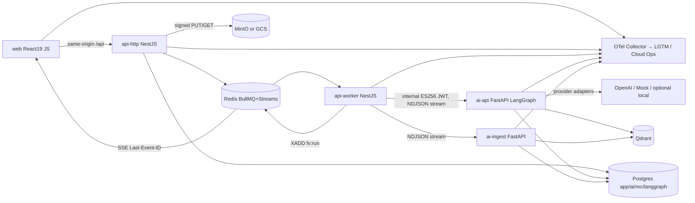
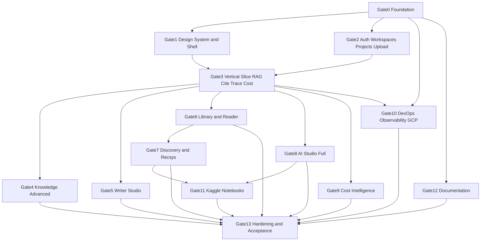

# FolioVerse AI — Autonomous Master Implementation Plan

Status: PLAN ONLY. No implementation has started. Repo `d:\Interview\PROJECTS\FolioVerse` is empty (verified). Execution begins only when the user switches to Agent mode and sends `BUILD` (Section R). Fallback copy of this plan is written to `docs/planning/MASTER_IMPLEMENTATION_PLAN.md` as task `FV-G00-STAT-013`.

---

## SECTION A — Final Architecture Confirmation

Frozen decisions (from Prompts 1–3; changes require a `DECISION_LOG.md` entry):

- Frontend: React 19 + Vite 6, **JavaScript/JSX only** (`jsconfig.json` with `checkJs` on `src/api/**` and `src/shared/**` using generated `.d.ts`), Tailwind v4 (`@theme` from design tokens), shadcn/Radix in JSX (`"tsx": false`), React Router v7 data mode, TanStack Query v5, Zustand, TipTap v3, react-pdf, epub.js behind `ReaderEngine`, @xyflow/react + dagre, Recharts, motion, lucide-react.
- Backend: NestJS 11 + TypeScript, Prisma (multiSchema: `app`, `ai`, `rec`; `langgraph` owned by the Python checkpointer), BullMQ + Redis, `jose` (ES256 internal JWT, HS256/ES256 user JWT), argon2id, class-validator, pino, Swagger export.
- AI service: FastAPI + Pydantic v2 + LangChain/LangGraph + `langgraph-checkpoint-postgres`, Unstructured (`fast`), pdfplumber, mammoth (Node side for DOCX HTML preview) / `python-docx` fallback, ebooklib, sentence-transformers (CPU torch, candidate `BAAI/bge-small-en-v1.5`), fastembed BM25 sparse, qdrant-client, scikit-learn. Same image, `ROLE=api|ingest`.
- Runtimes: `web`, `api-http`, `api-worker`, `ai-api`, `ai-ingest`, `migrate` (one-shot). Reverse proxy: Caddy (local) / Cloud Run same-origin routing (GCP).
- Job model: BullMQ is the only queue. NestJS owns run/ingestion lifecycle; Python executes bounded held-open streaming HTTP work units (NDJSON). Worker relays events to Redis Stream `fv:run:{runId}` (and `fv:ws:{workspaceId}`) → SSE with `Last-Event-ID` resume. Token deltas are not persisted; milestones and final content are.
- Data: workspace = tenant; PERSONAL workspace per user; composite FKs `(workspace_id, id)` on tenant tables; UUIDv7 app-generated; soft delete + 30-day purge; append-only `cost_entries`; Universal Source (`sources`, `source_versions` immutable, `SourceAnchor` JSON Schema); Universal AI Run ledger (`ai_runs`, `ai_run_events`, `node_executions`, `model_calls`, `usage_events`, `cost_entries`).
- Model routing: NestJS resolves `ModelPlan` at admission (registry + permissions + budget); Python may fall back only within the plan. Registry seeded `UNVERIFIED` from `config/models/registry.seed.yaml`; prices admin-entered with source URL + effective dates. Mock provider is deterministic and flagged `is_demo`.
- Cost tiers: PREFLIGHT_ESTIMATE / LIVE_ESTIMATE → FINALIZED (or FINAL_ESTIMATED) → RECONCILED (+ VARIANCE). Decimal only. Dedupe: `UNIQUE(model_call_id, stage)`, `UNIQUE(usage_event_id, entry_type)`. Reservation: conditional `UPDATE budget_periods ... WHERE spent_final + reserved_open + :amt <= :limit`.
- Auth: argon2id; 10-min access JWT in HttpOnly `fv_at`; rotating opaque refresh `fv_rt` with family reuse detection; double-submit CSRF `fv_csrf`; 404 for unauthorized resources; same-origin deployment.
- Observability: OpenTelemetry in all three services; Grafana LGTM locally (compose profile `observability`); Cloud Ops in GCP. Trace context propagates web → Nest → BullMQ job → Python → LangGraph node.
- Design: "Intelligent Atlas" tokens (`--fv-*`), light `#F6F5F1`/accent `#5A4BD1`/AI `#6A4CE0`; dark `#111216`/accent `#9488FF`; Studio always dark; dimensions rail 60/224, topbar 56, toolbar 46, context 260, inspector 330, drawer 440, editor 64ch, reader 62ch.
- Toolchain: Node 24 LTS (`.nvmrc`), pnpm 10 (`packageManager` field, single `pnpm-lock.yaml`), Python 3.12 + uv workspace (single `uv.lock`), Docker Compose v2. Line endings LF via `.gitattributes`. Windows host: all scripts are Node (`.mjs`) or cross-platform `pnpm` scripts, never bash-only.
- Honesty rules: DEMO/SIMULATED badges on mock data; no invented model IDs/prices; replay ≠ re-execution; no fabricated deployments.



---

## SECTION B — Repository Blueprint

```
FolioVerse/
  .github/workflows/{ci.yml,contracts.yml,e2e.yml,release.yml,kaggle-smoke.yml}
  .nvmrc  .python-version  .gitattributes  .editorconfig  .gitignore  .env.example
  package.json  pnpm-workspace.yaml  pnpm-lock.yaml  pyproject.toml  uv.lock  turbo.json
  docker-compose.yml  docker-compose.dev.yml  docker-compose.prod.yml
  README.md  AGENTS.md
  apps/
    web/            Vite React JS: src/{app,features,shared,api,stores,styles}, playwright/
    api/            NestJS: src/{main.ts,worker.ts,common,config,infra,modules/*}, prisma/{schema.prisma,migrations,seed}
    ai-service/     FastAPI: folioverse_ai/{main.py,settings,auth,routers,graphs,retrieval,ingestion,providers,ledger,telemetry}, tests/
    docs/           Astro Starlight
  packages/
    contracts/      schemas/*.schema.json, openapi/{api.json,ai.json}, generated/{web.d.ts,api-types.ts,ai_models.py}, fixtures/{pricing-cases.json,anchor-cases.json,citation-cases.json}, scripts/
    design-tokens/  tokens.json, build.mjs → dist/{tokens.css,tokens.js,tailwind.css}
    shared-config/  eslint, prettier, tsconfig.base.json, ruff.toml, pyrightconfig.json
    folioverse-ml/  Python: recsys, evaluation, features, artifacts (uv member)
  config/{models/registry.seed.yaml, pricing/README.md, features/flags.yaml}
  infrastructure/{docker/*.Dockerfile, caddy/Caddyfile, otel/, grafana/{dashboards,provisioning}, terraform/{modules,envs/lean,envs/standard}, scripts/*.mjs, runbooks/}
  ml-notebooks/     11 notebooks + jupytext .py pairs + requirements.txt
  datasets/{synthetic,evaluation}
  design-prototype/index.html
  tests/{e2e,integration,performance,security}
  docs/planning/{MASTER_IMPLEMENTATION_PLAN.md,IMPLEMENTATION_STATUS.md,DECISION_LOG.md}
```

---

## SECTION C — Dependency DAG



Critical path: G0 → G2 → G3 → (G5 | G8) → G13. G1 runs parallel to G2; G4/G5/G6/G8/G9 parallel after G3; G7 after G6; G10/G12 incremental from G0.

---

## SECTION D — Agent Ownership Matrix

Workstreams and exclusive file ownership (one owner per file path; others open PR-style requests via `DECISION_LOG.md` when they need a change):

- **A Platform/Foundation** — root configs, `pnpm-lock.yaml`, `uv.lock`, `packages/shared-config`, `turbo.json`, compose files, `docs/planning/*`. Owns the integration branch `main`.
- **B Contracts & Data** — `packages/contracts/**`, `apps/api/prisma/**` (sole Prisma migration author), `config/models/**`, generated types. Runs `contracts:check`.
- **C API Core (NestJS)** — `apps/api/src/**` except `prisma/`; BullMQ, SSE, auth, budgets, ledger worker.
- **D AI Service (Python)** — `apps/ai-service/**`, `packages/folioverse-ml/**`, Qdrant collections, LangGraph graphs, checkpointer schema.
- **E Web Shell & Design** — `packages/design-tokens/**`, `apps/web/src/{app,shared,stores,styles}`, `design-prototype/index.html`, visual regression.
- **F Web Features** — `apps/web/src/features/**`, `apps/web/src/api/**` (consumes generated `.d.ts` only).
- **G DevOps/Infra** — `infrastructure/**`, `.github/workflows/**`, Dockerfiles, Terraform, runbooks.
- **H ML/Kaggle/Eval** — `ml-notebooks/**`, `datasets/**`, evaluation harness in `apps/ai-service/folioverse_ai/evaluation`.
- **I Docs & QA** — `apps/docs/**`, `tests/**`, acceptance matrix, demo script.

Shared-contract rule: any change under `packages/contracts/schemas` or `prisma/schema.prisma` requires (1) B to publish, (2) C/D/F to regenerate in the same gate, (3) `contracts:check` green before merge.

---

## SECTION E — Gate-by-Gate Execution Plan

Task format: `ID · title · owner · size(S/M/L) · [P]=parallel-safe [EXT]=external dependency · deps · deliverables · validation · done-when`.

### Gate 0 — Foundation (all [P] after REPO-001)
- `FV-G00-REPO-001` Monorepo scaffold · A · M · deps none · `package.json` (scripts `dev up down lint test typecheck contracts:check db:migrate db:seed`), `pnpm-workspace.yaml`, `pyproject.toml` uv workspace, `.nvmrc`=24, `.python-version`=3.12, `.gitattributes` (`* text=auto eol=lf`), `.editorconfig`, `.gitignore` (node, python, `.env*` except `.env.example`), `turbo.json`, `AGENTS.md` · validate: `pnpm install`, `uv sync` succeed · done: clean clone installs on Windows + Linux.
- `FV-G00-REPO-002` Shared config · A · S · eslint flat config (JS web preset, TS api preset), prettier, `tsconfig.base.json`, `ruff.toml`, `pyrightconfig.json` · validate: `pnpm lint` passes on skeletons.
- `FV-G00-ENV-003` Env templates + validation · A · S · `.env.example` with every variable documented, `infrastructure/scripts/check-env.mjs`, Nest `ConfigModule` with zod schema, Python `pydantic-settings` · done: missing required var fails fast with named error, no secret values printed.
- `FV-G00-TOK-004` Design tokens package · E · M · `tokens.json` (Prompt 3 Part A values), `build.mjs` → `tokens.css` (light/dark `--fv-*`), `tailwind.css` (`@theme`), `tokens.js` · validate: snapshot test of generated CSS · done: web imports `@folioverse/design-tokens/tailwind.css`.
- `FV-G00-CON-005` Contracts package v0 · B · L · JSON Schemas: `source-anchor`, `event-envelope`, `run-events/*` (run.started, node.started, node.finished, retrieval.completed, token.delta, citation.validated, usage.recorded, run.finished, run.failed, heartbeat), `ingestion-events/*`, `run-spec`, `model-plan`, `scope-token`, `work-unit-request/response`; fixtures `pricing-cases.json` (≥25 cases incl. cached tokens, reasoning tokens, batch discounts, zero-price, missing-price → FINAL_ESTIMATED), `anchor-cases.json`, `citation-cases.json`; scripts `generate.mjs` (openapi-typescript → `web.d.ts`, json-schema-to-typescript, datamodel-code-generator) and `check.mjs` (diff) · done: `pnpm contracts:check` green with committed outputs.
- `FV-G00-WEB-006` Web skeleton · E · M · Vite + React 19 JSX, router data mode with `src/app/routes.js` mirroring Prompt 3 Part D, `jsconfig.json` (`checkJs` scoped), Tailwind v4, `components.json` (`tsx:false`), TanStack Query provider, placeholder pages per route · validate: `pnpm --filter web build`, Vitest smoke.
- `FV-G00-API-007` NestJS skeleton · C · M · `main.ts` (http) and `worker.ts` (BullMQ workers only), ConfigModule, PrismaModule (with `$extends` tenant scope stub), RedisModule (ioredis), `HealthModule` (`/live`, `/ready` checks db+redis+qdrant+storage), pino logger with redaction, RFC 9457 exception filter, global `ValidationPipe`, `swagger:export` CLI → `packages/contracts/openapi/api.json` · validate: Jest unit + Supertest `/ready`.
- `FV-G00-AI-008` FastAPI skeleton · D · M · `ROLE` env, `/healthz` `/readyz`, structlog JSON, internal JWT verification dependency (ES256 JWKS from env), `openapi:export` → `ai.json`, pytest scaffolding, `uv run` scripts · done: both roles start, unauthorized internal call → 401.
- `FV-G00-DB-009` Prisma init + slice schema · B · L · deps CON-005 · `schema.prisma` with `multiSchema`, UUIDv7 defaults via `@default(dbgenerated())` helper or app-side generator; tables for Gates 2–3: `users, sessions, auth_tokens, workspaces, workspace_members, invitations, projects, folders, sources, source_versions, documents, stored_objects, upload_sessions, ingestion_jobs, index_manifests, chunks(ai), threads, messages, message_citations, context_scopes, ai_runs, ai_run_events, node_executions, retrieval_events(ai), model_configs, model_prices, model_calls, usage_events, cost_entries, budget_policies, budget_periods, budget_reservations, audit_events, idempotency_keys` ; `migrations/0001_init`; seed scaffold; `scripts/langgraph-setup.py` for checkpointer schema · validate: `prisma migrate deploy` on fresh Postgres; constraint tests for dedupe uniques · done: migration applies idempotently.
- `FV-G00-DOCK-010` Docker Compose core · G · L · `docker-compose.yml`: postgres 16, redis 7, qdrant, minio + `minio-init` (bucket + CORS), mailpit, caddy, `api-http`, `api-worker`, `migrate`, `ai-api`, `ai-ingest`, `web`; healthchecks; `depends_on: condition: service_healthy`; profiles `observability`, `local-llm`; `docker-compose.dev.yml` bind mounts + HMR; multistage Dockerfiles (`web.Dockerfile` nginx/caddy static, `api.Dockerfile` node:24-slim, `ai.Dockerfile` python:3.12-slim with CPU torch wheel index, model pre-download layer) · validate: `docker compose config`, `docker compose up -d` → all healthy within 5 min cold.
- `FV-G00-DEV-011` One-command dev · A · S · deps DOCK-010 · `infrastructure/scripts/{up,down,wait-for-health,seed}.mjs`; `pnpm up` = compose up → wait → migrate → seed → print URLs · done: fresh machine `pnpm up` reaches login page.
- `FV-G00-CI-012` CI baseline · G · M · `ci.yml` with path filters, matrix jobs (web lint/test/build, api lint/typecheck/test, ai ruff/pyright/pytest, contracts check, docker build cache); no paid tokens (`FV_LIVE_PROVIDER_TESTS=0`) · done: green on first push.
- `FV-G00-STAT-013` Planning files · A · S · materialize `docs/planning/MASTER_IMPLEMENTATION_PLAN.md` (this plan), `IMPLEMENTATION_STATUS.md` (gate/task table as bullets with states PLANNED/IN_PROGRESS/DONE/BLOCKED), `DECISION_LOG.md` (ADR-lite entries) · done: files exist and are updated at every task completion.

Gate 0 done when: `pnpm up` yields healthy stack; `/api/ready` and `/ai/readyz` 200; web shell loads; CI green; contracts generated.

### Gate 1 — Design System & Application Shell (parallel with Gate 2)
- `FV-G01-PROTO-001` Materialize prototype · E · M · write `design-prototype/index.html` by stitching Prompt 3 parts (remove the truncated `const INS_OUT=` line, append part 2 after `'Generate Research Report','Create Knowledge Map'];`); open in Playwright, fix any syntax errors to spec; record 4 viewport screenshots as fidelity references `apps/web/playwright/reference/*.png` · done: all 14 prototype views render, palette/lens/drawer interactions work.
- `FV-G01-SHELL-002` AppShell + MainNavigation rail (60/224) + TopBar (56) + Breadcrumbs + ContextPanel (260) + Inspector (330) layout primitives · E · M.
- `FV-G01-UI-003` `shared/ui` primitives via shadcn JSX: Button, Input, Select, Dialog, Sheet, Tabs, Tooltip, DropdownMenu, Popover, Toast, Badge, Skeleton, ScrollArea, Separator, Progress, Table, Command · E · M · [P].
- `FV-G01-STATE-004` `shared/states.js` (Ingestion/Run/Outcome/Suggestion/DNA/Anchor/Citation vocabularies + colors) + `StatusBadge`, `StageTrack` · E · S · validate: every vocabulary value has a badge test.
- `FV-G01-OVL-005` Overlays: `Toaster`, `CommandPalette` (cmdk, route + action registry), `FolioLens` (anchored popover with action registry, loading/stream/abstain/error states), `EvidenceDrawer` shell (440), `RunReceipt` shell, `ModelSelector` shell · E · L.
- `FV-G01-THEME-006` `useThemeStore` (light/dark/system, Studio forced dark), reduced motion, font stacks · E · S.
- `FV-G01-A11Y-007` Focus trap/restore, skip link, roving tabindex utilities, shortcut registry (`?`, `Cmd/Ctrl+K`, `g k/w/l/d/s`) · E · S.
- `FV-G01-VR-008` Playwright visual regression harness: shell at 1280/1440/1920/mobile vs prototype references with 2% threshold · E/I · M.
- `FV-G01-DOC-009` `/app/docs/design` living component gallery route (states, tokens, overlays) · E · S.

Done when: all routes render in shell with placeholders; palette navigates; theme persists; VR baseline committed.

### Gate 2 — Auth, Workspaces, Projects, Upload
- `FV-G02-AUTH-001` Auth module · C · L · deps G00-DB-009 · register/login/refresh/logout/me; argon2id; `fv_at` (10 min), `fv_rt` rotating with family table + reuse detection → revoke family; `fv_csrf` double-submit middleware; `@nestjs/throttler` Redis store · validate: Supertest matrix (reuse detection, CSRF missing → 403, expired access → 401 then refresh) · done: Playwright register→login→refresh.
- `FV-G02-AUTHZ-002` Authorization · C · M · `PermissionsModule` (roles OWNER/ADMIN/EDITOR/VIEWER + personal workspace), `@RequirePermission`, `ResourceAccessGuard` resolving `(workspaceId,id)` and returning 404, `ScopedPrisma` extension injecting workspace predicate · validate: two-tenant fixture test suite `authz.matrix.spec.ts` (every endpoint × role).
- `FV-G02-MAIL-003` Email verification + password reset via Mailpit SMTP; templates; single-use hashed tokens · C · S.
- `FV-G02-WS-004` Workspaces/members/invitations; PERSONAL workspace at signup; switcher endpoint · C · M.
- `FV-G02-PROJ-005` Projects (kind KNOWLEDGE/WRITER/LIBRARY), folders (adjacency + materialized path), rename/move/archive/trash/restore; purge job (BullMQ `maintenance`) after 30 days · C · M.
- `FV-G02-UPL-006` Storage + uploads · C · L · `StoragePort` (S3-compatible MinIO adapter, GCS adapter behind same interface), `upload_sessions` with signed PUT (≤64MB single, multipart above), `complete` verifies size/sha256/magic bytes, allowed types pdf/docx/txt/md/epub, state UPLOADING→UPLOADED→SCANNING→PREVIEW_READY · validate: integration with MinIO Testcontainer.
- `FV-G02-SRC-007` Sources/versions/documents · C · M · immutable `source_versions`, `stored_objects`, signed GET, version list, "new version" flow · done: anchors reference `source_version_id`.
- `FV-G02-AUD-008` Audit interceptor (`audit_events`) + `Idempotency-Key` middleware (Redis + table) · C · S.
- `FV-G02-FE-009` Web features · F · L · auth pages (Prompt 3 `auth` view), onboarding, workspace switcher, Knowledge project page (tree + table + detail panel), upload dialog with XHR progress + per-file state badges, trash view · validate: Vitest component tests + Playwright.
- `FV-G02-TEST-010` Integration harness · I · M · Testcontainers (Postgres/Redis/MinIO), seed factories, Playwright project `auth-upload` · done: CI job `e2e` green with mock everything.

Done when: two users cannot see each other's data (404), upload reaches PREVIEW_READY, audit rows exist.

### Gate 3 — First Vertical Slice (detail in Section F)
- `FV-G03-ING-001` Ingestion orchestration · C · L · BullMQ queues `ingestion`, `ai-runs`, `ledger`, `maintenance`; `ingestion_jobs` state machine; `AiServiceClient` (undici, internal ES256 JWT, NDJSON reader, per-unit timeout, retry policy by error class) · validate: unit tests with fake NDJSON server.
- `FV-G03-ING-002` Python ingest pipeline · D · L · validators, preview, parse (Unstructured `fast`, pdfplumber word boxes), element normalization with locators (page, bbox, char offsets, heading path) · validate: golden fixtures per file type in `datasets/synthetic/docs`.
- `FV-G03-ING-003` Chunking · D · M · parent (≈1200 tok) / child (≈300 tok, overlap 15%) with tiktoken counts, table handling, `chunks` rows with locator JSON · validate: determinism test (same input → same chunk ids).
- `FV-G03-ING-004` Indexing · D · L · bge-small dense + fastembed BM25 sparse (IDF modifier) into Qdrant collection `fv_chunks_v1` (named vectors, payload `workspace_id, source_version_id, project_id, parent_id`), deterministic point ids, embedding cache table, `index_manifests` · done: READY/PARTIAL/FAILED/QUARANTINED transitions tested.
- `FV-G03-ING-005` Ingestion SSE · C/F · M · `GET /api/workspaces/:id/events` (Redis Stream `fv:ws:{id}`, Last-Event-ID), `useWorkspaceEvents()`, live `StageTrack` in table rows.
- `FV-G03-RAG-006` Scope resolution · C · M · `context_scopes` (project / selected sources / version pins), signed `ScopeToken` (ES256, 5-min, lists allowed `source_version_id`s or project filter) · validate: tampered token → 401 in Python.
- `FV-G03-RAG-007` Hybrid retrieval · D · L · Qdrant Query API prefetch dense+sparse → RRF, optional local cross-encoder rerank (flag), parent expansion, token-budget packer, `retrieval_events` rows, filter from ScopeToken only · validate: eval on `datasets/evaluation/qa-small.jsonl` with recall@k thresholds (logged, not gating).
- `FV-G03-RAG-008` Providers · D · M · `ProviderAdapter` base (LangChain chat model wrappers), `OpenAIAdapter`, `MockAdapter` (deterministic, seeded, `is_demo`), usage normalization (`input, output, cached_input, reasoning`) · validate: contract tests from `pricing-cases.json` usage shapes.
- `FV-G03-RAG-009` `grounded_qa` graph (T1) · D · L · nodes `resolve_scope → retrieve → (abstain if below threshold, no model call) → pack → generate (stream) → validate_citations → finalize`; Postgres checkpointer `thread_id = ai_run_id`; node instrumentation emits `node.started/finished`, `retrieval.completed`, `token.delta`, `citation.validated`, `usage.recorded`; `BudgetGuard` interrupt before generate when plan says so; `[S#]` citation parsing + deterministic validation (VALID/WEAK/UNRESOLVED) · validate: `citation-cases.json`, abstention test asserts zero `model_calls`.
- `FV-G03-RUN-010` Run lifecycle (NestJS) · C · L · `POST /api/runs` (RunSpec → ModelPlan via registry/permissions → preflight estimate → atomic reservation → `ai_runs QUEUED` → enqueue); worker: start unit, relay NDJSON → `XADD fv:run:{id}` (MAXLEN ~ 10k, TTL 24h), persist milestones to `ai_run_events`/`node_executions`/`model_calls`, final content to `messages`; cancel (`fv:cancel:{id}` flag polled by Python); heartbeat reaper → INTERRUPTED; states QUEUED/RUNNING/STREAMING/AWAITING_INPUT/SUCCEEDED/PARTIAL/FAILED/CANCELLED/INTERRUPTED/BUDGET_REJECTED · validate: state machine unit tests, crash-recovery integration test (kill worker mid-run → INTERRUPTED, stream resumable).
- `FV-G03-CONV-011` Conversations · C · M · threads, messages tree (`parent_message_id`), branches, `message_citations` with anchors; `GET /api/runs/:id/events` SSE with Last-Event-ID; message checkpoint every N tokens or 2s to allow refresh recovery.
- `FV-G03-LEDGER-012` Ledger · C/D/B · L · `config/models/registry.seed.yaml` → `model_configs` UNVERIFIED; `model_prices` empty until admin enters (fixture dev prices flagged `is_demo`); Python writes `usage_events`; NestJS `ledger` worker → `cost_entries` FINALIZED or FINAL_ESTIMATED, releases reservation, updates `budget_periods` (Decimal, single transaction); shared golden tests in TS (`pricing.spec.ts`) and Python (`test_pricing.py`) · done: both suites pass identical fixtures; re-processing a usage event yields no duplicate entry.
- `FV-G03-RCPT-013` Run Receipt + Evidence · C/F · M · `GET /api/runs/:id/receipt` (model plan, fallbacks, tokens, cost tier, retrieval stats, citation summary, trace link); `RunReceipt` and `EvidenceDrawer` bound to real data; citation chip → viewer highlight via anchor.
- `FV-G03-VIEW-014` Document workspace page · F · L · react-pdf viewer with text layer, anchor highlight (page + bbox/char range), version selector, chat panel with streaming (`useRunEvents`), branch tree, abstain UI, BUDGET_REJECTED UI · validate: Playwright `ask → stream → citation click highlights`.
- `FV-G03-STUDIO-015` Studio minimal · F/D · M · run explorer, graph render from `graph.get_graph()` JSON endpoint, node executions list, event timeline (read-only, dark theme).
- `FV-G03-COST-016` Cost minimal · F/C · S · personal MTD, per-run receipts list, estimate vs final badges.
- `FV-G03-E2E-017` Slice E2E · I · M · Playwright: register → upload fixture PDF → READY → ask → cited answer → open trace → receipt shows cost; mock provider in CI; `FV_LIVE_PROVIDER_TESTS=1` opt-in job for one real OpenAI call (manual dispatch only) [EXT].

Done when: Section F acceptance list is fully green with mock provider; live path verified once manually if key configured (else logged BLOCKED).

### Gate 4 — Knowledge Advanced
- `FV-G04-INS-001` Insight action registry (14 actions from prototype `INS_OUT`) mapped to graphs/tiers: summaries & key facts (T0 direct over packed context), study tools (T1), `multi_doc_compare` (T1), `risk_contradiction` (T1 with evidence pairs), knowledge map (T1 → artifact graph JSON) · D · L.
- `FV-G04-ART-002` `artifacts` table/API/UI (SUMMARY, FLASHCARDS, COMPARISON, RISK_REPORT, KNOWLEDGE_MAP) with source version pins and staleness flag when new version uploaded · C/F · M.
- `FV-G04-SRCH-003` Workspace search: Postgres FTS (titles/notes) + semantic (Qdrant) merged; palette integration · C/D/F · M.
- `FV-G04-CONV-004` Conversation management: rename/archive/search, branch compare view, attach/detach sources mid-thread (new `context_scope`) · C/F · M.
- `FV-G04-DOCX-005` DOCX/MD/TXT canonical reading view with paragraph anchors; version diff summary · F/D · M.
- `FV-G04-LENS-006` Folio Lens knowledge actions (explain, define, find related, add to notes) with selection anchors · F · M.
- `FV-G04-BATCH-007` Batch ops (multi-select ingest/move/delete) + ingestion retry/requeue UI · C/F · S.
- `FV-G04-MAP-008` Knowledge map canvas (@xyflow + dagre) with node → evidence drawer · F · M.

### Gate 5 — Writer Studio
- `FV-G05-DB-001` Schema: `manuscripts, manuscript_nodes, rich_docs, doc_revisions, suggestions, dna_facts, dna_links, continuity_issues, research_notes, excerpts` · B · M.
- `FV-G05-ED-002` TipTap v3 editor with stable `blockId` attribute, autosave (debounced PATCH with `revision` optimistic concurrency → 409 merge UI), IndexedDB draft recovery, word counts, focus mode (64ch) · F · L.
- `FV-G05-REV-003` Revisions + diff (`wdiff` port) + restore · C/F · M.
- `FV-G05-SUG-004` `writer_revision` graph (T0 per paragraph, batch mode) → `suggestions` PENDING; decorations in editor; accept/reject/undo; STALE on paragraph edit; SUPERSEDED on rerun · D/C/F · L.
- `FV-G05-DNA-005` Narrative DNA: facts (CANON/PROPOSED/RETIRED, origin AUTHOR/AI_EXTRACTED), links, evidence anchors into manuscript; StoryGraph canvas; `dna_extraction` graph proposes only · D/C/F · L.
- `FV-G05-CONT-006` `continuity_check` graph → `continuity_issues` with paired anchors; issue list + jump; resolve/dismiss · D/C/F · M.
- `FV-G05-RES-007` Research notes & excerpts (from Knowledge/Library) with source anchors; insert citation into manuscript as footnote block · C/F · M.
- `FV-G05-EXP-008` Export MD/DOCX (docx lib) and optional PDF (print CSS) · C/F · S.
- `FV-G05-LENS-009` Lens writer actions (rewrite tone, tighten, expand, continuity lookup) · F · S.

### Gate 6 — Library & Reader
- `FV-G06-DB-001` `books, library_items, collections, reading_progress, annotations, bookmarks` · B · S.
- `FV-G06-EPUB-002` EPUB ingestion (ebooklib → chapters as source elements with CFI locators) · D · M.
- `FV-G06-RDR-003` `ReaderEngine` adapter (`epubjs`, `pdf`) with unified `Locator`; reader page (62ch, typography prefs, progress) · F · L.
- `FV-G06-ANN-004` Highlights/notes/bookmarks with anchors; sync; annotation list · C/F · M.
- `FV-G06-EXPL-005` `passage_explain` graph (context cap: current chapter + prior summaries; spoiler guard) · D · M.
- `FV-G06-EXC-006` Excerpt → Writer research note; Lens reader actions · F · S.
- `FV-G06-META-007` Metadata enrichment clients (Open Library, Google Books) behind flags; cached; absent → manual entry [EXT optional] · C · S.
- `FV-G06-UI-008` Library grid/list/collections/reading stats · F · M.

### Gate 7 — Discovery & Recommendations
- `FV-G07-DB-001` `rec` schema: `catalog_items, item_themes, taste_profiles, interactions, recommendation_sets, recommendation_items, feedback` · B · S.
- `FV-G07-CAT-002` Synthetic catalog fixtures (≥500 items, labeled DEMO) + loader; optional TMDB/Open Library importers [EXT] · H · M.
- `FV-G07-ML-003` `folioverse-ml` recsys: feature builders (TF-IDF themes + embeddings), content-based + implicit CF (scikit-learn NMF/kNN), MMR diversification, explanation attribution, artifact manifest with version · H/D · L · validate: offline metrics on `datasets/evaluation/rec-holdout`.
- `FV-G07-API-004` `/ai/recommendations` endpoint + Nest proxy with permissions; `rec_explain` graph for natural-language rationale (T0) · D/C · M.
- `FV-G07-UI-005` Taste onboarding, Discover page (shelves, "why this", feedback), Discovery Lab (weights sliders, re-rank live) · F · L.
- `FV-G07-EVAL-006` Offline evaluation report job + Studio tab · H · S.

### Gate 8 — AI Studio Full
- `FV-G08-TM-001` State time machine: checkpoint list/get from LangGraph checkpointer (read-only), diff between checkpoints · D/F · M.
- `FV-G08-FORK-002` Fork/resume from checkpoint = new `ai_run` with `parent_run_id` + cost; replay (free) clearly separated · C/D/F · M.
- `FV-G08-CMP-003` Run compare (side-by-side answers, citations, cost, latency) · F · M.
- `FV-G08-XRAY-004` RAG X-Ray from `retrieval_events` (dense/sparse/fused ranks, rerank deltas, packer decisions) · F · M.
- `FV-G08-PLAY-005` Retrieval Playground (k, fusion, rerank on/off, chunk level) → new runs tagged LAB · D/F · M.
- `FV-G08-BATTLE-006` Model Battle: frozen retrieval, N models, blind vote, cost per answer · D/C/F · M.
- `FV-G08-FAIL-007` Failure Injection (LAB only, flag `FV_LAB_FAULTS`): provider timeout, 429, malformed JSON, Qdrant down → observe states/fallbacks · D/C · M.
- `FV-G08-TUTOR-008` Agent Tutor content panels (how this graph works, tier, costs) · F/I · S.
- `FV-G08-EVAL-009` Evaluation dashboard: `evaluation_runs` (faithfulness via citation validity, answer relevance via judge model opt-in, retrieval recall) · H/F · M.
- `FV-G08-CQ-010` Cost-vs-Quality scatter (Recharts) · F · S.

### Gate 9 — Cost Intelligence
- `FV-G09-PRICE-001` Admin price management (effective dates, source URL, currency, per-unit types), model verification toggle, registry diff view · C/F · M.
- `FV-G09-BUDG-002` Budget policies (workspace/user/project, hard/soft, periods), alerts (75/90/100%), BUDGET_REJECTED UX with estimate · C/F · M.
- `FV-G09-RECON-003` Reconciliation import (OpenAI usage export/API) → RECONCILED + VARIANCE entries; manual CSV import fallback [EXT] · C · M.
- `FV-G09-CLOUD-004` Cloud infra cost import (GCP Billing export → BigQuery) behind flag; manual entry fallback [EXT] · C · S.
- `FV-G09-LOCAL-005` LOCAL_COMPUTE cost class (embedding/rerank CPU seconds × admin rate) · D/C · S.
- `FV-G09-ROLL-006` Rollups (hourly/daily per workspace/user/model/feature), anomaly detection (z-score), estimator API · C · M.
- `FV-G09-UI-007` Cost dashboards (prototype `costs` view), CSV export with formula-injection escaping · F · M.

### Gate 10 — DevOps, Observability, GCP
- `FV-G10-OTEL-001` OTel SDKs in web (fetch/SSE spans), Nest (auto + BullMQ job propagation), Python (FastAPI + LangGraph node spans); `traceparent` carried in job payload and NDJSON header · C/D/E · M.
- `FV-G10-LGTM-002` Compose profile `observability`: otel-collector, Grafana LGTM; dashboards JSON (runs, ingestion, ledger, SSE), alert rules · G · M.
- `FV-G10-IMG-003` Production images hardening (non-root, read-only FS, healthchecks, SBOM via syft, Trivy scan in CI) · G · M.
- `FV-G10-REL-004` `release.yml`: build/push to Artifact Registry with WIF/OIDC, deploy Cloud Run services (web, api-http, api-worker min-instances 1, ai-api, ai-ingest), run `migrate` job; manual approval environment `production` [EXT] · G · L.
- `FV-G10-TF-005` Terraform `envs/lean` (Cloud Run ×5, one e2-standard VM with Postgres/Redis/Qdrant via compose, GCS bucket, Secret Manager, Artifact Registry, Cloud Ops) and `envs/standard` (Cloud SQL, Memorystore, LB) toggled by variables; `terraform validate` + `tflint` in CI only (no apply) [EXT] · G · L.
- `FV-G10-RUN-006` Runbooks (deploy, rollback, rotate secrets, restore backup, purge job), smoke test script against any base URL · G/I · S.
- `FV-G10-BKP-007` Backup scripts (pg_dump to bucket, Qdrant snapshot) + restore test · G · S.

### Gate 11 — Kaggle Notebooks
- `FV-G11-NB-001..011` Eleven notebooks (jupytext paired `.py`): 1 Document Parsing & Chunking, 2 Embedding Comparison, 3 Hybrid Retrieval & RRF, 4 Reranking Ablation, 5 Citation Validation Metrics, 6 RAG Evaluation Harness, 7 Cost Modeling & Token Economics, 8 Recsys Content/CF/MMR, 9 Taste Profile Clustering, 10 Narrative DNA Extraction Eval, 11 LangGraph Trace Analytics · H · each M · shared `ml-notebooks/requirements.txt`, `datasets/synthetic` only, `KAGGLE_SMOKE=1` runs ≤2 min with tiny samples · validate: `kaggle-smoke.yml` executes via `jupytext --execute` on CI; artifacts exported to `datasets/evaluation/results/`.
- `FV-G11-LINK-012` Studio Evaluation tab links to notebook outputs; docs page listing notebooks · H/I · S.

### Gate 12 — Documentation
- `FV-G12-SITE-001` Astro Starlight at `apps/docs` (served at `/docs`), sections: Getting Started, Architecture (Prompt 2 content), Design System, API Reference (generated from `api.json`/`ai.json`), Data Model (Prisma ERD via `prisma-erd-generator`), Runbooks, Decision Log mirror, Interview Guide · I · L.
- `FV-G12-SHOT-002` Playwright-generated screenshots pipeline (`pnpm docs:shots`) — real app only, never fabricated · I · S.
- `FV-G12-INAPP-003` In-app `/app/docs` help with status badges (IMPLEMENTED / DEMO / BLOCKED) sourced from `IMPLEMENTATION_STATUS.md` · F/I · S.

### Gate 13 — Hardening & Acceptance
- `FV-G13-SEC-001` Security test suite (Section M) · I/C · L.
- `FV-G13-A11Y-002` axe-core on every route; keyboard-only Playwright pass · I/E · M.
- `FV-G13-VR-003` Visual regression vs prototype references; fix drifts > 2% · E · M.
- `FV-G13-PERF-004` k6: 50 concurrent SSE streams, 20 concurrent ingestions; p95 targets recorded · I · M.
- `FV-G13-SEED-005` Demo seed (Project Atlas docs, *The Glass Meridian*, *Orbit of Small Lanterns*, DEMO catalog) + `pnpm demo` script · A/I · M.
- `FV-G13-ACC-006` Run Section P checklist; update `IMPLEMENTATION_STATUS.md` with evidence links; write interview demo script · I · M.
- `FV-G13-FIX-007` Defect burn-down from acceptance; `DECISION_LOG.md` finalization · all · L.

---

## SECTION F — First Vertical Slice Deep Plan (Gate 3)

Sequence (each step cites tasks; all with mock provider unless noted):

1. Register/login (`G02-AUTH-001`) → PERSONAL workspace + default Knowledge project (`G02-WS-004`, `PROJ-005`).
2. Upload `datasets/synthetic/docs/atlas-brief.pdf` via signed PUT → `complete` → `UPLOADED→SCANNING→PREVIEW_READY` (`G02-UPL-006`, `SRC-007`); `sources` + `source_versions` v1 created.
3. `POST /api/sources/:id/versions/:vid/ingest` → `ingestion_jobs` PARSING → BullMQ `ingestion` job → worker opens NDJSON work unit `POST /ai/ingest/units` with internal JWT (`G03-ING-001`).
4. Python parses, normalizes, chunks, embeds, upserts Qdrant, writes `chunks` + `index_manifests`, streams `stage` events; worker relays to `fv:ws:{workspaceId}`; UI StageTrack moves PARSING→INDEXING→READY (`ING-002..005`).
5. User asks in Document chat → `POST /api/runs` with `RunSpec{graph:'grounded_qa', scope:{sourceVersionIds:[v1]}, modelPreference}` → NestJS: permission check, `ModelPlan` (primary mock/openai, fallback), preflight estimate from `model_prices` (or FINAL_ESTIMATED marker), atomic reservation, `ai_runs QUEUED`, `threads/messages` user message, enqueue `ai-runs` (`RUN-010`, `CONV-011`, `RAG-006`, `LEDGER-012`).
6. Worker starts unit `POST /ai/runs/units` with RunSpec + ScopeToken + traceparent; Python runs `grounded_qa` (`RAG-007..009`): retrieve (RRF) → threshold → pack → stream generate → validate citations → emit `usage.recorded` → `run.finished`.
7. Worker relays all events to `fv:run:{runId}`; persists `node_executions`, `retrieval_events` (Python writes directly to `ai` schema), `model_calls`, `message_citations`, final assistant message; marks SUCCEEDED/PARTIAL/ABSTAINED outcome.
8. Web `useRunEvents(runId)` consumes SSE (`GET /api/runs/:id/events`), renders token deltas, citation chips `[S1]`; chip click → Evidence Drawer → viewer highlight by anchor (`VIEW-014`, `RCPT-013`).
9. `ledger` worker consumes `usage_events` → `cost_entries` FINALIZED (or FINAL_ESTIMATED), releases reservation, updates `budget_periods` (`LEDGER-012`).
10. Run Receipt shows plan, tokens, cost tier, retrieval stats, citation validity, "Open in Studio" → Studio graph + timeline (`STUDIO-015`), Costs page shows MTD (`COST-016`).

Key contracts frozen before Gate 3 coding: `run-spec`, `model-plan`, `scope-token`, `event-envelope` + all `run-events/*` and `ingestion-events/*`, `work-unit-request/response`, `source-anchor`, `pricing-cases.json`, `citation-cases.json`, `anchor-cases.json`, OpenAPI `api.json` for `/auth /workspaces /projects /sources /uploads /runs /threads /receipts`.

Acceptance (all automated in `FV-G03-E2E-017`):
- Fresh `pnpm up` → register → upload → READY within 2 min (CPU embeddings).
- Question answered with ≥1 VALID citation whose anchor highlights the correct page region.
- Unanswerable question → ABSTAINED with zero `model_calls`.
- Refresh mid-stream resumes via Last-Event-ID without duplicate tokens.
- Killing `api-worker` mid-run → run INTERRUPTED, UI shows state, no orphan reservation after reaper.
- Receipt cost equals ledger `cost_entries` sum; golden pricing tests pass in TS and Python.
- Trace in Studio shows every node with durations; trace id links web → api → ai spans (local LGTM).
- Second user gets 404 on first user's source/run/thread.

---

## SECTION G — Parallel Execution Schedule

- Phase 0 (serial): `G00-REPO-001` → then all other Gate 0 tasks in parallel by owner (A, B, C, D, E, G).
- Phase 1 (parallel): Gate 1 (E) ‖ Gate 2 (C, F, I) ‖ Gate 0 CI/doc leftovers (G, I) ‖ Gate 12 skeleton (I) ‖ Gate 10 OTEL-001 scaffolding (G).
- Phase 2 (critical): Gate 3 — D builds ING/RAG while C builds RUN/LEDGER against frozen contracts; F builds VIEW/RCPT against mock SSE fixtures; integration daily on `main`.
- Phase 3 (parallel): Gate 4 (D, F) ‖ Gate 5 (D, C, F) ‖ Gate 6 (D, F) ‖ Gate 8 (D, F) ‖ Gate 9 (C, F) ‖ Gate 10 (G) ‖ Gate 12 content (I).
- Phase 4: Gate 7 (H, D, F) after Gate 6; Gate 11 (H) after 7 & 8.
- Phase 5 (serial): Gate 13.
- Merge protocol: owners work on branches `ws/<letter>/<task-id>`; A merges into `main` after CI; conflicts in shared files resolved by the file owner only. When executing as a single agent, the same ordering is followed sequentially and `IMPLEMENTATION_STATUS.md` records that execution was sequential (never claim concurrency that did not occur).

---

## SECTION H — Contract Gates

- CG-1 (before Gate 1/2 coding): design tokens v1; route registry; state vocabularies; Prisma slice schema; OpenAPI auth/workspace/project/upload paths.
- CG-2 (before Gate 3 coding): all run/ingestion event schemas, RunSpec/ModelPlan/ScopeToken, work-unit protocol, SourceAnchor, pricing/citation/anchor fixtures, usage normalization shape.
- CG-3 (before Gates 4–9): module-specific schemas (artifacts, suggestions, DNA, annotations, recommendations, budgets) and OpenAPI paths; Prisma migrations `0002..0007`.
- CG-4 (before Gate 10 release): `.env.example` complete; health endpoints; OTel attribute conventions (`fv.workspace_id`, `fv.run_id`, `fv.graph`, `fv.node`).
- Enforcement: `contracts.yml` fails on uncommitted generated diffs; schema version field in every envelope; breaking change requires `DECISION_LOG.md` entry + regeneration in same PR.

---

## SECTION I — UI Fidelity Plan

- Source of truth: `design-prototype/index.html` (materialized `G01-PROTO-001`) + Prompt 3 tokens; reference screenshots at 4 viewports committed.
- Tokens flow one way: `tokens.json` → CSS vars → Tailwind theme; no hard-coded colors in features (eslint rule `no-restricted-syntax` on hex literals in JSX).
- Component map (Prompt 3 Part D) implemented 1:1; each prototype view maps to a route page; Studio forces dark.
- Shared patterns mandatory: FolioLens, EvidenceDrawer, RunReceipt, StatusBadge/StageTrack, ModelSelector, DEMO badges.
- Verification: `G01-VR-008` baseline; `G13-VR-003` compare; axe and keyboard passes; motion respects `prefers-reduced-motion`.

---

## SECTION J — AI/ML & Kaggle Plan

- Retrieval: bge-small dense + BM25 sparse → RRF (k=60) → optional cross-encoder (`BAAI/bge-reranker-base`, flag) → parent expansion → budget packer. Eval: recall@5/10, MRR on `datasets/evaluation/qa-small.jsonl` (synthetic, generated deterministically from fixture docs).
- Graphs (tiers): grounded_qa T1, multi_doc_compare T1, risk_contradiction T1, writer_revision T0, continuity_check T1, dna_extraction T1, passage_explain T0/T1, research_writing T2 (Gate 5 stretch, agentic loop with tool budget), rec_explain T0.
- Checkpointer: Postgres, `thread_id=ai_run_id`; replay reads checkpoints; fork creates new run.
- Recsys: content-based (TF-IDF + embeddings cosine) + implicit CF (NMF) blend → MMR → explanations by feature attribution; artifact manifest `rec_model_v{n}.json`.
- Evaluation harness: `folioverse_ai/evaluation` with faithfulness (citation validity ratio), retrieval recall, latency, cost; judge-model metrics opt-in only.
- Kaggle: 11 notebooks (Gate 11) run on synthetic data, CPU, ≤ 2 min smoke; outputs feed Studio Evaluation tab.
- Model registry seed: provider families and placeholders only; model IDs are entered/verified by admin; code never hardcodes prices.

---

## SECTION K — Docker, CI/CD & GCP Plan

- Local: `docker-compose.yml` (core) + `dev` override + profiles `observability`, `local-llm` (Ollama, optional), `security` (Trivy one-shot). `pnpm up/down`.
- CI (`ci.yml`): lint/typecheck/test per app with path filters, contracts check, docker build with GHA cache, Trivy scan, Playwright e2e against compose (mock provider). No paid tokens.
- Manual workflows: `live-provider-tests.yml` (requires `OPENAI_API_KEY` secret, manual dispatch), `kaggle-smoke.yml`.
- Release (`release.yml`): tag → build → push Artifact Registry (WIF/OIDC, no JSON keys) → Cloud Run deploy → `migrate` job → smoke → manual approval gate for `production` environment.
- GCP Lean: Cloud Run (web, api-http, api-worker min 1, ai-api, ai-ingest min 0, 2 vCPU/4 GB for Python), one VM (Postgres, Redis, Qdrant via compose, persistent disk, daily snapshot), GCS bucket, Secret Manager, Cloud Ops. Standard: Cloud SQL, Memorystore, Qdrant on VM or managed, HTTPS LB. Terraform validated in CI; `apply` only by user with configured credentials [EXT].
- Cost guardrails: `max-instances` caps, budget alerts in Terraform, no autoscaling beyond configured limits.

---

## SECTION L — Observability & Ledger Plan

- Trace path: web span `fv.run.request` → `POST /api/runs` → BullMQ job (traceparent in payload) → worker span → HTTP to Python (W3C headers) → FastAPI span → LangGraph node spans (`fv.graph`, `fv.node`, `fv.run_id`) → provider call span (no prompt content) → Qdrant span.
- Logs: pino/structlog JSON with `run_id`, `workspace_id`, `trace_id`; redaction of tokens, cookies, source content; sampling for token deltas (not logged).
- Metrics: run durations by graph/node, tokens by model, cost by class/tier, SSE connections, queue depth, ingestion stages, retrieval latency, abstention rate.
- Dashboards: Grafana JSON committed; GCP Cloud Monitoring equivalents in Terraform.
- Ledger invariants (tested): append-only (`cost_entries` no UPDATE/DELETE grants for app role), dedupe uniques, Decimal everywhere, reservations released exactly once, `SUM(cost_entries)` = receipt total, estimate→final→reconciled lineage via `supersedes_entry_id`.

---

## SECTION M — Security & Failure Testing

- Authz matrix (every endpoint × role × foreign tenant → 404/403 as designed); IDOR fuzz with UUIDv7 neighbors.
- Auth: refresh reuse → family revoked; CSRF missing/mismatch → 403; cookie flags (HttpOnly, Secure in prod, SameSite=Lax); argon2 params; rate limits on auth endpoints.
- Upload: MIME spoof (magic bytes), zip-bomb EPUB guard (size/entries limits), path traversal in filenames, oversized files, malformed PDF → QUARANTINED not crash.
- Internal boundary: Python rejects missing/expired/tampered internal JWT and ScopeToken; Qdrant filters always derived from token.
- Prompt-injection in documents: retrieved text never alters system instructions (test with injected fixtures; citations still validated).
- Secrets: gitleaks in CI; logs redaction tests; `.env` never committed.
- Failure injection (Gate 8 LAB + integration tests): provider timeout/429/5xx → fallback within plan or FAILED with receipt; Qdrant down → ingestion FAILED retryable; Redis restart → SSE reconnect + resume; worker crash → INTERRUPTED via reaper; budget exhausted → BUDGET_REJECTED before any model call.
- Dependency scanning: `pnpm audit`, `pip-audit`, Trivy images; CSV formula-injection escaping tests.

---

## SECTION N — External Setup Matrix

Status at plan time: all UNCONFIGURED. Each item: when needed · variables · fallback · status.

- OpenAI API key (or other provider) · Gate 3 live path, Gate 8 Battle, Gate 9 recon · `OPENAI_API_KEY`, `FV_LIVE_PROVIDER_TESTS` · mock provider · BLOCKED-until-provided.
- GCP project + billing + WIF pool + Artifact Registry · Gate 10 release/Terraform apply · `GCP_PROJECT_ID`, `GCP_WIF_PROVIDER`, `GCP_SA_EMAIL`, `GCP_REGION` · local compose + `terraform validate` only · BLOCKED.
- GitHub repo + Actions secrets/environments · Gate 0 CI push · repo remote, `production` environment · local runs of same scripts · BLOCKED until remote exists.
- Domain + TLS · Gate 10 · Caddy local self-signed; Cloud Run default URL · optional.
- SMTP provider · Gate 2 prod email · Mailpit locally · optional.
- TMDB / Open Library / Google Books keys · Gate 6–7 enrichment · synthetic DEMO catalog · optional.
- GCP Billing export → BigQuery · Gate 9 cloud costs · manual CSV import · optional.
- Kaggle account · Gate 11 publishing · notebooks run locally/CI · optional.
- Hugging Face model downloads (bge-small, reranker) · Gate 3 build · pre-download at image build; offline cache dir `HF_HOME` · needs network once.

---

## SECTION O — Requirements Traceability Matrix

Feature → route(s) → modules → gate:
- Auth/onboarding → `/auth/*`, `/onboarding` → api `auth, users`; web `features/auth` → G2.
- Workspaces/projects/folders/trash → `/app`, `/app/knowledge/:projectId` → `workspaces, projects`; `features/knowledge` → G2.
- Upload/ingestion states → same → `uploads, sources, ingestion`; ai `ingestion` → G2–G3.
- Document workspace, viewer, chat, branches, citations → `/app/knowledge/:projectId/doc/:sourceId` → `runs, threads`; ai `graphs/grounded_qa, retrieval`; `features/document` → G3.
- Insights/artifacts/knowledge map/search → `/app/knowledge/*`, palette → `artifacts, search`; ai graphs → G4.
- Writer editor/revisions/suggestions → `/app/writer/:manuscriptId` → `manuscripts, suggestions`; ai `writer_revision` → G5.
- Narrative DNA/StoryGraph/continuity → `/app/writer/:id/dna`, `/continuity` → `dna`; ai `dna_extraction, continuity_check` → G5.
- Library/reader/annotations/passage explain → `/app/library`, `/app/library/read/:itemId` → `library, annotations`; ai `passage_explain` → G6.
- Discovery/taste/lab → `/app/discover`, `/app/discover/lab` → `recommendations`; `folioverse-ml` → G7.
- AI Studio (traces, time machine, X-Ray, battle, playground, failure lab, evaluation) → `/app/studio/*` → `studio`; ai `introspection` → G3 (min), G8.
- Cost Intelligence/budgets/prices/reconciliation → `/app/costs`, `/app/admin/pricing` → `ledger, budgets, pricing` → G3 (min), G9.
- Admin/model registry → `/app/admin/*` → `admin, models` → G9.
- Settings/theme/a11y → `/app/settings` → `features/settings`, shell → G1.
- In-app docs → `/app/docs` → `apps/docs` + status → G12.
- Observability/deploy → n/a → infrastructure → G10.
- Notebooks → n/a → `ml-notebooks` → G11.

---

## SECTION P — Final Acceptance Checklist (verification commands)

- `pnpm install && uv sync` — clean install.
- `pnpm lint && pnpm typecheck && uv run ruff check . && uv run pyright` — static checks green.
- `pnpm contracts:check` — generated artifacts in sync.
- `pnpm up` — stack healthy; `curl -f http://localhost/api/ready` and `curl -f http://localhost/ai/readyz`.
- `pnpm test` — Vitest + Jest + `uv run pytest` green (including `pricing` golden tests in both languages).
- `pnpm test:integration` — Testcontainers suites (authz matrix, ledger invariants, run state machine, crash recovery).
- `pnpm test:e2e` — Playwright: vertical slice, writer suggestions, reader annotations, discovery feedback, studio replay, budgets rejection, a11y (axe), visual regression.
- `pnpm test:security` — security suite (Section M).
- `pnpm demo` — seeds demo workspace; manual walkthrough script in `docs/planning/DEMO_SCRIPT.md`.
- `docker compose --profile observability up -d` — Grafana shows end-to-end trace for a run.
- `pnpm kaggle:smoke` — all notebooks execute in smoke mode.
- `pnpm docs:build` — Starlight builds; `/docs` served.
- `terraform -chdir=infrastructure/terraform/envs/lean validate` — passes; deployment itself recorded as BLOCKED unless credentials configured by user.
- `IMPLEMENTATION_STATUS.md` shows every task DONE or BLOCKED with reason; no task marked DONE without passing validation.

---

## SECTION Q — Autonomous Agent Execution Instructions

- Execute gates in Section C order; within a gate follow task dependencies; mark each task IN_PROGRESS → DONE/BLOCKED in `IMPLEMENTATION_STATUS.md` immediately, with validation evidence (command + result summary).
- Record every deviation from frozen decisions in `DECISION_LOG.md` (context, decision, consequences). Never silently change stack, schema ownership, or contracts.
- Respect file ownership; generated files are regenerated, never hand-edited.
- Verification before DONE: run the task's validation; for UI tasks compare against prototype; for data tasks run migrations on a fresh DB.
- Honesty: label mock/synthetic data DEMO; treat unconfigured integrations as BLOCKED; never fabricate deployments, screenshots, metrics, model IDs, or prices; replay ≠ re-execution; do not claim parallelism that did not happen.
- Safety: never print or commit credentials; never delete unrelated files; no destructive cloud ops, purchases, billing changes, production deploys, or irreversible production DB changes without explicit configured authorization; Cursor approval controls remain authoritative.
- Cost: CI and default tests use the mock provider; live tests only with `FV_LIVE_PROVIDER_TESTS=1` and an explicit user-provided key.
- Logging: no private source content or secrets in logs by default.
- Checkpointing: after each gate, summarize status, blockers, and next gate in `IMPLEMENTATION_STATUS.md`; commit with message `feat(gate-N): <summary>` on the integration branch (local git init at Gate 0 if no remote).
- Priorities: P0 = Gates 0–3, 13 acceptance of slice; P1 = Gates 4–6, 8–10; P2 = Gates 7, 11, 12 polish. Priority orders work; it never drops scope.
- If output limits interrupt, resume from the last recorded task in `IMPLEMENTATION_STATUS.md`.

---

## SECTION R — BUILD Trigger Protocol

- This plan is saved as the Cursor Plan and, at Gate 0, mirrored to `docs/planning/MASTER_IMPLEMENTATION_PLAN.md`.
- No implementation in PLAN mode. When the user switches to Agent mode and sends `BUILD`, begin at `FV-G00-REPO-001` within permissions already configured in Cursor.
- First actions on BUILD: (1) create planning files (`STAT-013`) and `git init`, (2) scaffold monorepo, (3) proceed through Gate 0, (4) report Gate 0 status before Gate 1/2.
- External blockers are recorded, not worked around; the user is told exactly which variables/accounts unblock them.
- Any message other than `BUILD` in Agent mode is treated as a plan refinement request unless it explicitly authorizes implementation.
